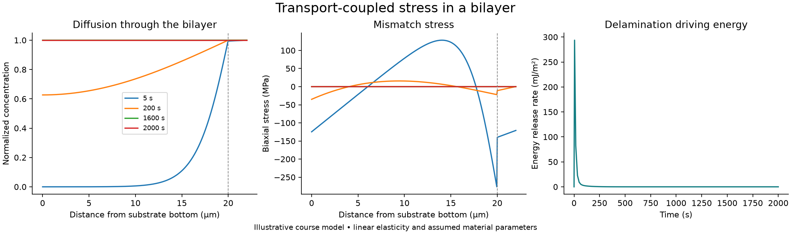

# Thin-Film Diffusion and Mismatch Stress

A materials-modeling course project connecting transient diffusion in a bilayer to mismatch strain, elastic stress, curvature and delamination driving energy. Developed by John Goodman for UCSB MATRL 263 / ME 267, Spring 2026.



The figures use assumed material parameters. They are calculations from a linear-elastic model, not experimental film measurements or a prediction that a particular interface will fail.

## Run the example

Use Python 3.10 or newer from a repository checkout:

```bash
python -m venv .venv
# macOS/Linux:
source .venv/bin/activate
# Windows PowerShell instead: .venv\Scripts\Activate.ps1
python -m pip install -e ".[test,plot]"
python run_model.py
python -m pytest
```

The run writes a summary JSON, through-thickness profiles, an energy history CSV and the overview plot under `output/demo/`. Importing the model does not start a simulation or write output files. To run without plotting, omit the `plot` extra and use `python run_model.py --no-plots`.

## Coupled model

1. Solve one-dimensional Fickian diffusion with piecewise diffusivity, a sealed substrate bottom, and a fixed surface concentration at the film top.
2. Convert concentration to stress-free mismatch strain using `epsilon_star = beta * concentration`.
3. Solve free-laminate force and moment equilibrium for membrane strain and curvature.
4. Evaluate biaxial stress and the difference between bonded elastic energy and the energies of the two freely relaxed layers.

The geometry contains a 20 µm substrate and 2 µm film. Young's moduli are 200 and 100 GPa; Poisson's ratio is 0.30 for both. Diffusivities are 1e-12 and 1e-10 m²/s, and the coupling coefficient is 0.002 per unit normalized concentration. These are illustrative inputs, retained from the coursework example.

The default run uses 441 nodes, a maximum time step of 2 s, and a 2,000 s horizon. Requested output times are reached exactly. The concentration remains within [0,1], while transient mismatch stress and delamination driving energy relax as the concentration becomes uniform.

## Numerical verification

The tests check a homogeneous analytical diffusion mode, inventory conservation in a sealed domain, stationary uniform fields, exact snapshot timing, zero stress for uniform eigenstrain, and refinement toward an independent layerwise analytical laminate solution. An end-to-end run checks bounded concentration and late-time stress-energy relaxation.

The finite-difference transport scheme uses backward Euler and harmonic face diffusivities. The coupled stress calculation uses numerical quadrature across piecewise material properties. Numerical error remains, especially near the material interface and at early times. A stable time step does not establish temporal accuracy.

The film diffusion timescale is approximately 0.04 s, so the default output cadence and maximum 2 s step do not resolve the initial film transient. A reported peak is the **largest saved value**, not a proven maximum over continuous time. Use smaller steps and earlier output times when investigating that regime.

## Files to inspect

| File | Purpose |
|---|---|
| `run_model.py` | Importable simulation and CLI with configurable resolution/output |
| `solvers/layered_transport.py` | Diffusion and thermal-analogue solvers adapted from the author's HW2 code |
| `solvers/laminate_stress.py` | Analytical layerwise laminate solution from the author's HW1 code |
| `solvers/coupled_stress.py` | Nodal mismatch-to-stress and energy calculation from the final project |
| `tests/test_physics.py` | Analytical limits, conservation and refinement checks |

See [methods, provenance and limitations](docs/METHODS.md). Course PDFs, assignment prompts, instructor solutions and unpublished research data are not included.
